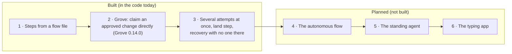

# What's built vs planned

The numbered steps are the plan's, from the repository's
`docs/work/261121-autonomous-direction/steps.md`.

## Built

Everything elsewhere on this site is built. By plan step:

1. **Steps from a flow file** (change 261121-gapde, PR #15). The `build` and
   `propose` loops are built-in flows, and a project replaces them with
   `tend/flow.yaml`. See [flows](concepts/flows.md).
2. **Grove: claim an approved change directly** (Grove 0.14.0). Merging a
   proposal approves the change, and a runner claims it by name, with no
   cycle to plan: `tend <repo> <change-id>`.
3. **Several pieces of work at once, and landing**, as five changes:
    - 261122-fh9h2 (PR #21): requested changes count only from people with
      write access.
    - 261122-nh8aa (PR #22): `tend <repo> <change-id>` builds an approved
      change no cycle lists.
    - 261122-9vbmc (PR #23): a [lock](concepts/locks.md) per work item, and
      `watch: {at_once: N}`.
    - 261122-rpkqa (PR #27): the [`land`](concepts/landing.md) step.
    - 261122-hjhmn (PR #29): watch reruns an attempt whose tend died, and a
      step whose agent is gone is asked once more ([recovery](concepts/recovery.md)).

### Known ceilings today

- Agents run as the OS user that holds the bot's token, so a determined agent
  could post its own `tend/review`.
- Two changes that cross a boundary only in combination are tested together
  at landing (CI on the merged target) but not judged together by a reviewer.

!!! note "For maintainers"
    That file's step 3 status line still reads "none approved or built yet";
    all five of its changes are merged.

Also built on the way: skipping startup notices (261121-m9bxm), the rex
`--add-dir` dialog fix (261121-7a3cz), the code split by behavior
(261123-yzdm6), and naming the drafter after its repository (261124-60tny).

## Planned

!!! warning "Not built"
    Nothing in this section exists in tend today. It is the plan as written
    on 2026-11-21, with open questions still to settle.

### 4. The autonomous flow

Status: not started.

Steps a project opts into so work flows without a person: decompose a goal
into requests, check a proposal, plan. With them, the owner would still hold:

- the rules agents work under, as protected paths (the flow file, CI, the
  ruleset, CODEOWNERS, the principles file, `grove.yaml`, agent instructions,
  skills, deploy config);
- what the product is, and the parts of money and data no file shows;
- spend: a daily cap counting every prompt tend sends unattended;
- agent ideas: work for an outcome the owner accepted flows; an outcome an
  agent adds is a pitch and waits.

To settle first: how to verify approval and reference outcomes, what a built
pitch is, who answers a proposal's open questions when no person approves it,
and whether a project can ask for approval before production.

### 5. The standing agent

Status: not started. Needs step 4.

One agent the owner talks to. It writes down goals and requests, reads status
and reports, and holds no authority to approve, plan or merge. Where it runs,
how it is reached, what it may write and how it recovers context are open.

### 6. The typing app

Status: not started. Needs steps 3 to 5. No repository yet.

A touch-typing practice site, the first project to run in the autonomous mode.

### Parked

- Querying the work graph, several machines claiming different changes, and
  another machine taking over a lost attempt. A shared store such as Dolt
  may be revisited.
