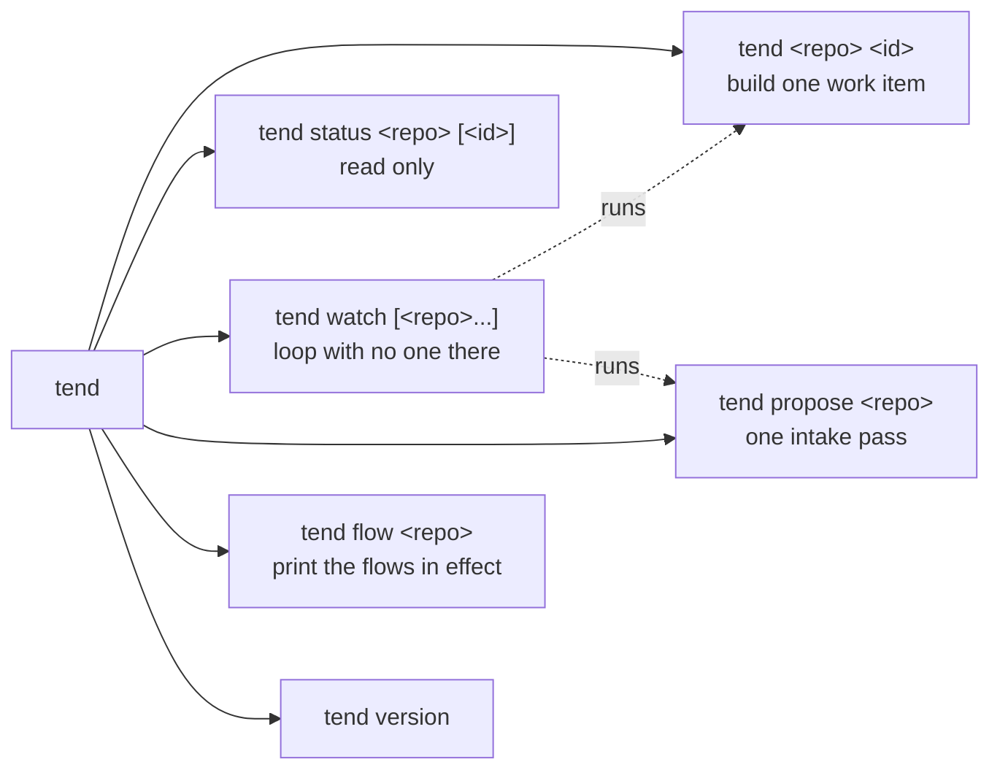

# Commands



Run tend inside a Herdr pane or a rex terminal. Every command prints its
messages on standard error as `tend: …`; `tend <repo> <id>` prints the final
verdict JSON on standard output. The output below is real: the usage and
`flow` lines from this repository, the rest from tend's acceptance tests,
whose agents and GitHub are stand-ins (paths shortened).

## `tend <repo> <id>`

Builds one [work item](concepts/work-items.md): `<id>` is a Grove change or
cycle ID, `issue-<n>`, or a Jira key. See [How a run goes](run.md) for what
happens and the [exit codes](run.md#exit-codes).

```text
$ tend
usage: tend <repo> <id>
[exit 2]
```

```text
$ tend ~/src/repo 261016-c0001
tend: claimed 261016-c0001 as attempt 261125-23fz9 in <worktree>
tend: not publishing: ~/src/repo.git is not listed in ~/.local/state/tend/publish
tend: done: grove/261125-23fz9, verdict ~/.local/state/tend/runs/261125-23fz9/verdict-69894e2341ab23a0898fd8fce54abe25ce29f094.json
{
  "head": "69894e2341ab23a0898fd8fce54abe25ce29f094",
  "conclusion": "success",
  "actionable": false,
  "summary": "ok"
}
```

An issue in a repository without Grove:

```text
$ tend ~/src/repo issue-7
tend: issue #7 on tend/build-7 in <worktree>
tend: published https://example.test/pr/tend_build-7
tend: done: tend/build-7, verdict ~/.local/state/tend/runs/issue-7-3060941693/verdict-a6b6438a84c0149fffab43e48c222ef8eb05457f.json
```

A stop, then the same command again:

```text
$ tend ~/src/repo 261114-k0000
tend: claimed 261114-k0000 as attempt 261125-k7kp7 in <worktree>
tend: impl-261125-k7kp7: stub_failure
[exit 3]
$ tend ~/src/repo 261114-k0000
tend: carrying on attempt 261125-k7kp7 in <worktree>
tend: not publishing: ~/src/repo.git is not listed in ~/.local/state/tend/publish
tend: done: grove/261125-k7kp7, verdict ~/.local/state/tend/runs/261125-k7kp7/verdict-33a247afcc73c04e93c355de8444a6ebf5ec1113.json
```

A second tend on the same work item while one runs:

```text
$ tend ~/src/repo 261114-k0000
tend: another tend is on 261114-k0000 in ~/src/repo: pid 48850, 261114-k0000 in ~/src/repo
[exit 4]
```

Exit codes: `0` done (the verdict is printed, or nothing to do), `1` an
unexpected failure, `2` usage, `3` a person is needed, `4` another tend is on
this work item. See [exit codes](run.md#exit-codes).

## `tend status <repo> [<id>]`

Reads only: it takes no lock and prompts nobody, so it works while tend runs.

With a work item, it shows the newest attempt, whether a tend is on it now,
and its last status with the next action:

```text
$ tend status ~/src/repo 261114-k0000
attempt 261125-dwmge of 261114-k0000: grove/261125-dwmge in <worktree>
2026-11-24T22:34:08-0700 done: success for grove/261125-dwmge at 45914b8, verdict ~/.local/state/tend/runs/261125-dwmge/verdict-45914b823a2c447289dd504808a728ac0b3f849f.json
next: a person reviews https://example.test/pr/grove_261125-dwmge and decides whether to merge it
```

```text
$ tend status ~/src/repo 261114-k0000
attempt 261125-k7kp7 of 261114-k0000: grove/261125-k7kp7 in <worktree>
2026-11-24T22:34:08-0700 needs-you: impl-261125-k7kp7: stub_failure
next: a person deals with that, then runs tend again
```

If the status says `working` but no tend holds the lock, it adds
`next: tend stopped before this finished; run it again, …`. With no attempt:
`no attempt at <id>`.

Without a work item, it says what waits for whom in the repository: Grove's
approved changes in no cycle and cycles not done (each with Grove's verdict),
this runner's attempts, proposals and implementations to review, and
labelled requests not yet drafted:

```text
$ tend status ~/src/repo
Approved changes in no cycle:
  261016-c0001 Another: 261016-c0001 is in flight in attempt 261125-23fz9, which <host> started at 2026-11-24T22:34:09-07:00 on branch grove/261125-23fz9
Cycles not done:
  261114-k0000 One: grove claim 261114-k0000 would claim it; it is not marked unattended; grove claim given no piece is paused after attempt 261125-23fz9 of 261016-c0001
Attempts on this runner, for cycles and changes not done and issues:
  261125-23fz9 (261016-c0001): done: success for grove/261125-23fz9 at 69894e2, verdict ~/.local/state/tend/runs/261125-23fz9/verdict-69894e2341ab23a0898fd8fce54abe25ce29f094.json
Proposals to review (answer their questions, revise or merge):
Implementations to review (review and merge):
Requests waiting for tend propose:
```

The text after each change and cycle is Grove's own verdict on it, as
`grove changes --json` gives it. Proposals are open pull requests from `tend/issue-*` or `tend/jira-*`;
implementations are those from `grove/*` or `tend/build-*`, marked
"changes requested: tend makes them on its next run" when GitHub says so.
Without `gh`, it ends with `GitHub: not readable with gh here`.

## `tend watch [<repo>...]`

Loops for ever, one pass every `WATCH_SECONDS`. See [watch](concepts/watch.md).

```text
$ WATCH_ONCE=1 tend watch ~/src/repo
tend: starting 261016-c0001 in ~/src/repo
tend: claimed 261016-c0001 as attempt 261125-ghff5 in <worktree>
tend: published https://example.test/pr/grove_261125-ghff5
tend: done: grove/261125-ghff5, verdict ~/.local/state/tend/runs/261125-ghff5/verdict-21b19d414f84e7822be2a131bdc2405e6f3719b1.json
```

(That repository's flow file sets `watch: {at_once: 1}`.)

## `tend propose <repo>`

One [intake](concepts/intake.md) pass: requests labelled `tend` become
proposal pull requests.

```text
$ tend propose ~/src/repo
tend: issue #1: https://example.test/pr/tend_issue-1
```

## `tend flow <repo>`

Prints the flows the repository's attempts would run, each headed by where it
comes from (`built in`, or `tend/flow.yaml on origin/<target>`). Saved as
`tend/flow.yaml`, the output is a valid flow file that behaves the same.
It fetches origin's target first, and changes nothing else. For this
repository, which has no flow file:

```text
$ tend flow .
# The flows tend runs in ~/src/tend, read from origin/main. Saved as tend/flow.yaml, with
# the prompt files it names under tend/ where yours differ from tend's own,
# it is what attempts run.

# build: built in
# build: a Grove cycle or a work item, from its worktree to a reviewed head.
# The implementer builds it, a fresh reviewer judges each head, one repair
# follows a failure the reviewer calls actionable, tend publishes the head,
# and changes a person requests on the pull request go back to the
# implementer.
build:
  start: implement
  steps:
    implement:
      agent: claude
      prompt: prompts/implement-{kind}.md
      result: commit
      next:
        ok: review
    review:
      agent: codex
      prompt: prompts/review.md
      result: verdict verdict-{head}.json
      next:
        success: publish
        failure: publish
        actionable: repair
    repair:
      continue: implement
      prompt: prompts/repair.md
      result: commit
      limit: 1
      next:
        ok: review
        spent: publish
    publish:
      next:
        ok: end
        requested: request
    request:
      continue: implement
      prompt: prompts/request.md
      result: commit or file reply-{review_id}
      next:
        ok: review

# propose: built in
# propose: a request labelled tend, drafted as a Grove proposal. The drafter
# writes it, then commits it or says why there is none, and tend opens the
# pull request or answers the request.
propose:
  start: draft
  steps:
    draft:
      agent: claude
      prompt: prompts/draft.md
      next:
        ok: follow
    follow:
      continue: draft
      prompt: prompts/follow.md
      result: commit or file declined
      next:
        ok: publish
    publish:
      next:
        ok: end
```

## `tend version`

```text
$ tend version
tend dev
```

A release prints its version; a build from a checkout prints `dev`.

## Environment

| Variable | Default | What it does |
| --- | --- | --- |
| `TEND_STATE` | `$XDG_STATE_HOME/tend`, else `~/.local/state/tend` | Where tend keeps its files. See [TEND_STATE](concepts/tend-state.md). |
| `TEND_TERMINAL` | Herdr, or rex when `REX_SESSION` is set and `HERDR_ENV` is not `1` | `herdr` or `rex`: where agents run. |
| `TIMEOUT_MS` | `14400000` (4 hours) | How long tend waits for one prompt, and for checks at `land`. |
| `WATCH_SECONDS` | `300` | Time between watch passes. |
| `WATCH_ONCE` | unset | Set: watch does one pass, waits for what it started, and exits. |
| `AT_ONCE` | unset | Lowers watch's count on this machine; `0` starts nothing new. |
| `CAP` | `5` | Most open proposal pull requests per repository. |
| `JIRA_EMAIL`, `JIRA_API_TOKEN` | unset | Jira credentials, passed to `curl` on its standard input. |
| `TEND_INSTALL_DIR` | `~/.local/bin` | Where `install.sh` puts tend. |
