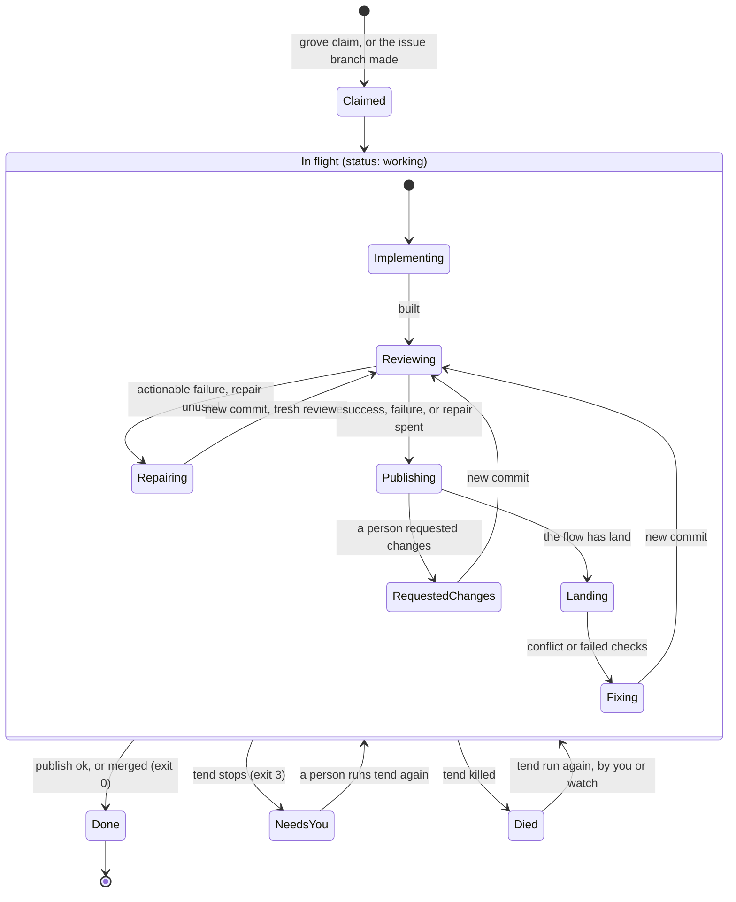

# Attempts

An [attempt](../glossary.md#attempt) is one try at a work item. For Grove work
it is the record `grove claim` makes, with an ID like `261125-dwmge` and the
branch `grove/261125-dwmge`. For an issue it is named after the issue and the
repository: `issue-7-<cksum>` or `jira-scrum-5-<cksum>`.

Each attempt has:

- a **worktree** with its branch, opened as a place in the terminal, where its
  agents' panes run;
- a **run folder**, `TEND_STATE/runs/<attempt-id>/`, holding its verdicts,
  records and status (see [TEND_STATE](tend-state.md));
- an **implementer**, the Claude session `impl-<attempt-id>`, kept for the
  whole attempt, and a fresh **reviewer** `rev-<short head>` for each head.

What the attempt is doing is in its `status` file, one of three kinds:
`working`, `needs-you` or `done`, with the next action. `tend status` shows it.

On a rerun, tend uses the newest attempt at the work item whose checkout
still holds its branch, and carries on. If there is none, it claims a new one.
The diagram's states are not stored anywhere: each run works out where the
attempt is from Git, the run folder, the terminal and GitHub. `Landing`
and `Fixing` (the `resolve` and `fix` steps) happen only in a flow that
lands; the built-in flow has no `land`. `Done` and `NeedsYou` are the status
kinds `done` and `needs-you`.
