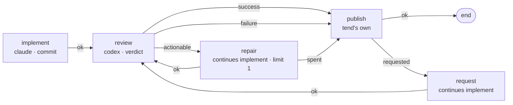

# Flows and steps

*The built-in `build` flow.*

A [flow](../glossary.md#flow) is the set of steps an attempt walks once it has
its branch and worktree. tend has two built in: `build` (above) and `propose`
(used by [intake](intake.md)). A [step](../glossary.md#step) is an agent given
a prompt, a result tend checks when the agent's turn ends, and where each
outcome goes next: another step, `end`, or `person` (tend stops for one).

- `agent: claude` or `agent: codex` starts a fresh agent with tend's own flags.
  `continue: <step>` prompts that step's agent again, in its conversation.
  The first step's agent (the implementer, or the drafter) lasts the whole
  attempt; any other fresh agent is new for each head, as the reviewer is.
- `result` is what counts as done: `commit` (a new commit), `file <name>` or
  `verdict <name>` in the run folder, or `commit or file <name>`. With no
  result, the turn ending is enough.
- `limit` caps how often a step is asked in an attempt. Once used, the
  outcome is `spent`.
- `publish` and `land` are tend's own steps: a flow only places them and says
  what follows.

**A project changes its flows** with `tend/flow.yaml` on its target branch,
read from origin's copy (`origin/<target>`), never from the attempt's own
branch, so an agent cannot change the flow it runs in. A flow the file names
replaces the built-in one; a flow it leaves out stays built in. Prompt files
are looked up under `tend/` on the target first, then in tend's own. tend
checks the file before any agent starts and stops (exit 3) if it is not valid.

`tend flow <repo>` prints the flows in effect. Every field, outcome and
placeholder is in the [Flows reference](../flows-reference.md).
