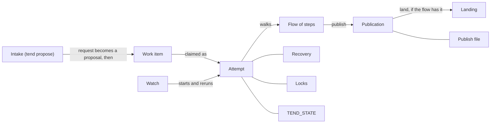

# Concepts

One short page each. Terms are defined once, in the [Glossary](../glossary.md).

| Page | In one line |
| --- | --- |
| [Work items](work-items.md) | What you can ask tend to build: a change, a cycle, `issue-<n>` or a Jira key. |
| [Attempts](attempts.md) | One try at a work item: a branch, a worktree, a run folder. |
| [Flows and steps](flows.md) | The steps an attempt goes through, built in or from `tend/flow.yaml`. |
| [Publication](publication.md) | The branch, pull request, reviews and status, as a bot account. |
| [Landing](landing.md) | Merging a reviewed pull request, one at a time, only if the flow says so. |
| [Watch and its count](watch.md) | The loop that starts and reruns work with no one there. |
| [Intake](intake.md) | `tend propose`: requests labelled `tend` become Grove proposals. |
| [Recovery](recovery.md) | How a rerun carries on after a stop, a kill or a reboot. |
| [Locks](locks.md) | How tends on different work items stay out of each other's way. |
| [TEND_STATE](tend-state.md) | Where tend keeps its own files. |
| [The publish file](publish-file.md) | Which repositories tend publishes, and as whom. |
