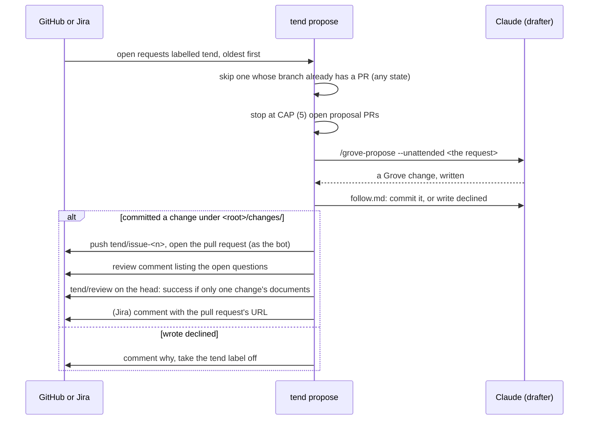

# Intake

[Intake](../glossary.md#intake) is `tend propose <repo>`: one pass that turns
requests into Grove proposals. It needs a repository that uses Grove and
whose origin is listed in the [publish file](publish-file.md).

- **Requests** are open GitHub issues labelled `tend`, and issues labelled
  `tend` and not done in a Jira project mapped to the repository.
- For each, oldest first, a Claude session with no one in it (the drafter,
  `prop-<n>-<cksum>`) runs `/grove-propose --unattended` on the request's
  title, description and link. Then it commits the change with a squash-ready
  message ending `Refs #<n>`, and writes a summary of open questions,
  consequential ones first.
- tend pushes `tend/issue-<n>` (or `tend/jira-<KEY>`) and opens a pull request
  as the bot account. Its review lists the open questions and what merging
  with them open means.
- **Status.** tend sets [`tend/review`](../glossary.md#tend-review) on the
  head of each proposal it opened: `success`, "Grove documents only: merging
  approves this change", when every path the head changes against the target
  lies in one change's folder under `<root>/changes/`; `failure`, naming why,
  otherwise. Each pass checks the open proposals first, whatever the cap, so
  a person's revision pushed to the branch gets its own status; a head the
  bot already set one on is left. You merge a proposal with the ordinary
  Merge button, no bypass.
- If no change can be drafted, the drafter writes why. tend comments that on
  the request and takes the `tend` label off. Putting the label back tries
  again.
- A pull request from the request's branch, **in any state**, means it is
  handled and never drafted again. At most `CAP` (default 5) proposal pull
  requests stay open per repository.

Merging the proposal approves the change. Building it is a separate step:
`tend <repo> <change-id>`, or [watch](watch.md) with a count. Labelling an
issue hands its text to an agent in auto mode, so only people who can label
(triage access) can send requests.

Intake takes the lock named `intake` for the repository, so a second
`tend propose` on the same repository exits 4. Its folders are under
`TEND_STATE/intake/<owner>_<repo>-<n>/`.
