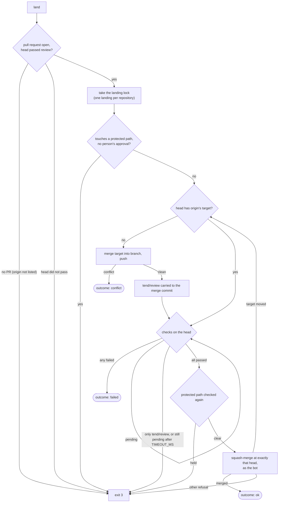

# Landing

[Landing](../glossary.md#landing) is tend merging a pull request itself. No
built-in flow has a `land` step, so by default **tend merges nothing**. A
project opts in by adding `land` to the `build` flow in `tend/flow.yaml`; see
[Setup](../setup.md#supervised-or-autonomous) for the two shapes.

At `land`, tend takes a head that passed review (or one carried from it) whose
pull request is open, and, one landing at a time per repository on this
runner:

0. **Holds a head that touches a protected path.** If the head's change
   against the target touches a [protected path](../flows-reference.md#protected-paths),
   it lands only once a person with write access has approved that head (or
   the head it is carried from). Otherwise tend merges nothing and stops
   (exit 3), naming the paths. This is checked again just before the merge,
   with the protected paths read afresh from the target.
1. **Merges the target in** when the head lacks the target's tip, as a merge
   commit pushed without force. A clean merge keeps the verdict: the merge
   commit gets `tend/review` "carried from" the reviewed head, with no new
   review. A conflict is aborted and gives `conflict`.
2. **Waits for every check** GitHub reports on the head, check runs and commit
   statuses alike, for at most `TIMEOUT_MS`. Success, neutral and skipped
   pass. Anything else gives `failed`, and the failed checks' names and links
   go to the next prompt as `{checks}`. A head with **no check but
   `tend/review`** stops for a person: a project lands only with CI on its
   pull requests.
3. **Squash-merges** through GitHub's merge API at exactly that head, as the
   publishing account. The commit's subject is the pull request's title and
   number, its body the description. If the target moved, it starts again
   from 1. If GitHub still waits for a required check, it waits. Any other
   refusal stops for a person with GitHub's reason.

If a person merged the pull request meanwhile, `land` sees it and gives `ok`.
tend ships `prompts/conflict.md` and `prompts/failed.md` for the steps that
follow `conflict` and `failed`. A flow whose `publish` names `failed` waits for
the same checks before a person is asked (see [Publication](publication.md)).
Sent to the same `fix`, the two share its limit, so an attempt gets one fix for
failed checks in all.
