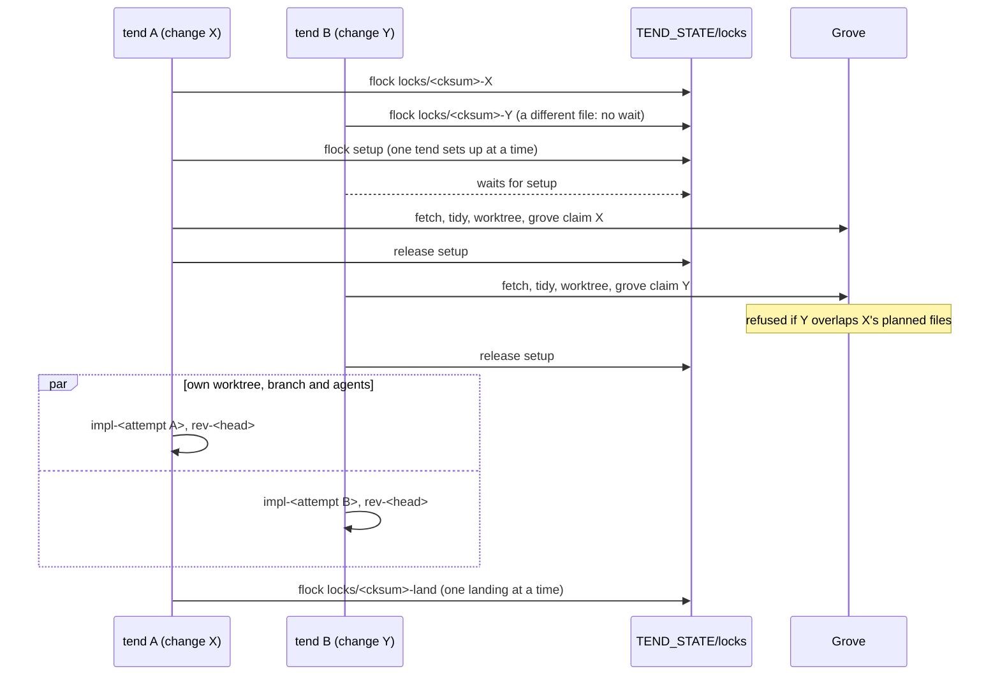

# Locks

Tends on different work items run at once. Four things keep them apart.
The locks cover one runner (one `TEND_STATE`); across machines, only Grove's
claim keeps work apart.

1. **One tend per work item.** Each tend holds an `flock` on
   `TEND_STATE/locks/<cksum>-<work item>`. The `<cksum>` names the
   repository by its common Git directory, so a symlink, a subfolder or a
   linked worktree share one lock. A second tend on the same work item waits
   about two seconds, then exits 4, naming the holder (`pid …, <id> in
   <repo>`). The lock goes when its holder exits or is killed, even if its
   agents live on. `tend propose` uses the work item `intake`.
2. **One setup at a time.** While one tend fetches, tidies, makes its worktree
   and claims, others on the same `TEND_STATE` wait on `TEND_STATE/setup`.
3. **Grove's claim.** Grove refuses a claim that overlaps work in flight (for
   example, a planned file another attempt holds), on any machine. tend stops
   with Grove's sentence and leaves no worktree or branch.
4. **Separate places.** Each attempt has its own worktree, branch, run folder
   and agents, named after the attempt (`impl-<attempt-id>`) or head
   (`rev-<short head>`).

**Containment.** After each implementer turn, tend compares the repository's
worktrees and local branches with a record made just before the prompt. A new
worktree, a new branch with commits, or the attempt's worktree on another
branch stops the attempt (exit 3), and nothing is reviewed or published. What
tend's other attempts and intake passes made is not held against it.

**Landing** takes one more lock, `locks/<cksum>-land`, so only one candidate
per repository lands at a time on this runner. The others wait for it.

`tend status <repo> <id>` reads the lock without taking it: `tend is on it:
pid …`.
