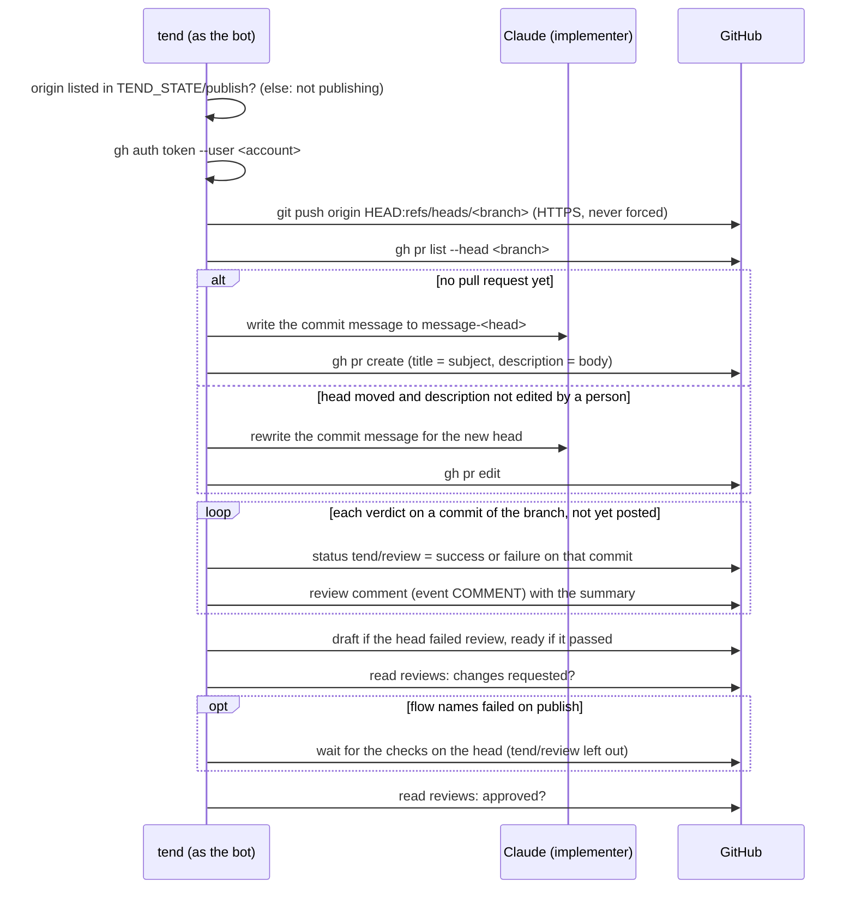

# Publication

[Publication](../glossary.md#publication) is the built-in `publish` step. It
happens only when the repository's `origin` URL is listed in the
[publish file](publish-file.md) with the GitHub account to publish as.
Otherwise tend says `not publishing: <origin> is not listed in
<TEND_STATE>/publish` and the verdict stays local. Without `origin`, nothing is
published.

Every write is the bot account's, never yours, so you can approve its pull
requests:

- **Branch.** Pushed over HTTPS with the bot's token, even if origin is an SSH
  URL, and never forced. A branch someone else pushed to stops for you.
- **Pull request.** One, onto the target, ready to squash-merge. Its title and
  description are the commit message the implementer writes for the reviewed
  head. After a later head, it is written again, unless a person has edited
  it since.
- **Reviews.** Each verdict is a comment review on its own commit (GitHub does
  not let a pull request's author approve or request changes). The head's
  review includes `grove review`'s summary of what merging approves.
- **Status.** Each reviewed commit gets the `tend/review` commit status, so a
  later commit has no passing result until it is reviewed.
- **Draft.** A pull request whose head failed review is made a draft; one that
  passed is made ready.

Nothing is remembered: the pull request and reviews are looked up on GitHub
every run, so a rerun repeats neither.

After publishing, the step's outcome is:

- `requested` when a person **with write access** (owner, member or
  collaborator) used "Request changes" on the head and it is not answered yet.
  The implementer gets their review and line comments once (`request.md`). It
  either commits, and the new head is reviewed and published, or makes no
  change and its reply is posted as a comment and not asked again. Plain
  comments, and requests from anyone without write access, are ignored.
- `failed`, only in a flow that names it, when a check on the head failed.
  Such a flow has `publish` wait, once no change is requested, for every
  check GitHub reports on the head, read as [landing](landing.md) reads them
  but with `tend/review` left out. It waits before it reads an approval, so an
  approved head whose check fails still gives `failed`. A head with no check
  but `tend/review`, or one still unfinished, after `TIMEOUT_MS` stops for a
  person (exit 3). The failed checks go to the next step as `{checks}`. If
  that step is spent (tend's own flow sends `failed` to the `fix` that
  `land` uses, limit 1, so one fix in all), tend says so once on the pull
  request, naming the failed checks, and gives `approved` or `ok` as it would
  have.
- `approved`, only in a flow that names it, when the newest such review on the
  head approves.
- `ok` otherwise.

**Afterwards.** Once the pull request is merged or closed, the next `tend` or
`tend propose` in that repository removes the worktree, its local branch and
the agents' place, if the worktree's head is the pull request's and it holds
no uncommitted files; otherwise it leaves it and says why.

tend does not wait for people at `publish`, only for checks in a flow that
names `failed`. While it waits for them, the attempt counts toward
[watch's](watch.md) `at_once`. [Watch](watch.md) runs the attempt
again when a change request or approval arrives. Merging stays a person's,
unless the flow has a [`land`](landing.md) step.
