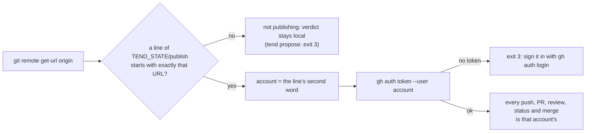

# The publish file



The [publish file](../glossary.md#publish-file) is `TEND_STATE/publish`. Each
line names a repository's origin URL and the GitHub account to publish as:

```text
git@github.com:you/your-repo.git your-bot
```

- The URL must match `git remote get-url origin` exactly, as written.
- The account is a separate one, such as a bot user with write access, signed
  in to `gh` beside yours: `gh auth login` as the bot, then `gh auth switch`
  back. tend takes its token (`gh auth token --user <account>`) for its own
  calls only.
- Because every write is the bot's, you can approve its pull requests.
- No line means: the build still runs and is reviewed, but nothing is pushed
  (`tend: not publishing: <origin> is not listed in <TEND_STATE>/publish`).
  `tend propose` and `land` need the line and stop without it.

The agents run as your OS user, so they could reach the bot's token. That is
a known ceiling, not a boundary.
