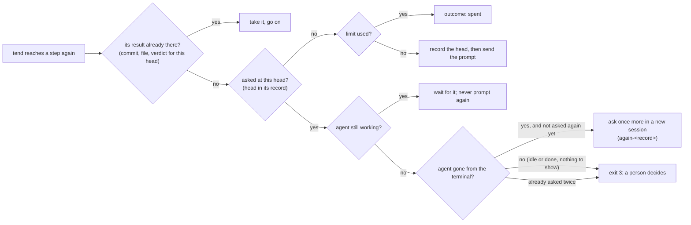

# Recovery

[Recovery](../glossary.md#recovery) is how a rerun carries on. tend keeps no
"current step". Each run walks the flow from the start, and each step is
judged afresh from Git, the run folder and the terminal. So after exit 3, a
kill, or a reboot, the same command carries on where the last one was.

- **Records.** Just before a step's prompt goes, tend writes the head into the
  step's record in the run folder (`<step>-asked`, a head a line). A prompt the
  terminal refused before sending is taken off again. A timeout or stall is
  not proof the prompt was undelivered, so it stays asked and is never sent
  twice to an agent that is still there.
- **Still working.** An agent still on its turn, as after tend was killed, is
  waited for and never prompted again.
- **Gone.** A step that was asked and left nothing, whose agent the terminal no
  longer has (after a reboot, or Herdr or rex restarting), is asked once more
  in a new session, which finds the work in Git. That second ask is recorded
  in `again-<record>` and does not count toward the step's limit. Never a
  third time.
- **Idle with nothing to show.** If the agent is there and idle, it may have
  acted on the prompt, so tend stops for you. It names the record to delete
  to have the step asked again.
- **Blocked or unknown.** An agent in either state stops for you.
- **The repair is used once asked.** `repair-asked` holds the reviewed head.
  If that head has no commit since and the implementer is there and not
  working, tend stops on every run until you commit a fix or delete
  `repair-asked`.
- **Verdicts.** A verdict counts only if it names the head and is complete.
  An invalid one is kept as `.rejected-<time>` and the head is reviewed again.
- **Loops.** A step reached again at the same head with nothing asked since
  stops for a person, rather than going round for ever.

To cancel, stop tend (Ctrl-C or a kill). The agents keep their work. Stop an
agent in its pane if you want it stopped too. `TIMEOUT_MS` (default four
hours) is how long tend waits for one prompt; a timeout does not stop the
agent. [Watch](watch.md) reruns an attempt whose tend died.
