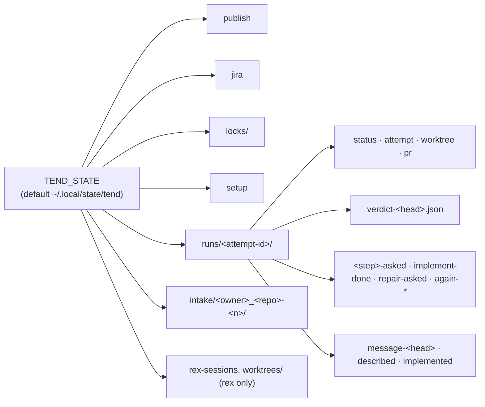

# TEND_STATE

[TEND_STATE](../glossary.md#tend_state) is the folder where tend keeps its own
files. It is `$TEND_STATE`, else `$XDG_STATE_HOME/tend`, else
`~/.local/state/tend`. Nothing in it enters the candidate branch, so a
repository needs no Git excludes. Tends that share a `TEND_STATE` share locks
and see each other's attempts; that is one **runner**.

| Path | What it holds |
| --- | --- |
| `publish` | Which origins tend publishes, and as whom. See [the publish file](publish-file.md). |
| `jira` | Jira projects mapped to repositories: `<site> <project-key> <origin-url>` a line. |
| `locks/` | One lock file per work item per repository, plus `intake` and `land`. See [locks](locks.md). |
| `setup` | The lock one tend holds while it sets up. |
| `runs/<attempt-id>/` | One folder per attempt (below). |
| `intake/<owner>_<repo>-<n>/` | One folder per request [intake](intake.md) handled: `asked`, `followed`, `summary`, `declined`, `pr`, `linked`. |
| `rex-sessions`, `worktrees/` | Under rex only: the session for each worktree, and the worktrees Git makes. |

A run folder holds:

| File | What it is |
| --- | --- |
| `status` | What the attempt is doing: time, `working`/`needs-you`/`done`, text, then `next: …`. |
| `attempt` | The repository and work item, for watch. |
| `worktree` | The attempt's worktree, for tidying and containment. |
| `verdict-<head>.json` | The reviewer's verdict on that head. |
| `<step>-asked` | The heads the step was asked at, one a line. |
| `implement-done` | Asks of the implementation whose turn tend saw end. |
| `again-<record>` | A step asked once more after its agent was gone. |
| `request-<review id>` | A person's change request, asked of the implementer. |
| `answered-<node id>`, `reply-<head>` | The implementer's reply to a request, posted or quoted. |
| `message-<head>`, `described` | The commit message for a head, and the head the PR description was written for. |
| `implemented` | An issue build's notes for the reviewer. |
| `pr`, `approves`, `carried-<head>`, `layout` | The pull request URL, whether publish acts on approval, a head carried across a clean merge, and the repository layout before the last implementer prompt. |

The `.tend/` folder an old prototype kept in the checkout is moved here on
the next run. A name clash stops for you rather than overwriting either.
