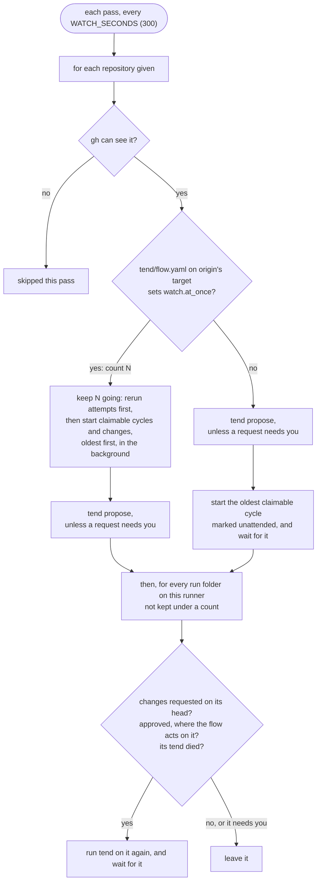

# Watch and its count



`tend watch [<repo>...]` is a loop for running with no one there. It runs in a
pane of its own. Every `WATCH_SECONDS` (default 300) it does one pass:

1. For each repository you named, it reads the [count](../glossary.md#count)
   from `tend/flow.yaml` on origin's target:

    ```yaml
    watch:
      at_once: 2
    ```

    - **With a count**, it keeps that many attempts of the repository going on
      this runner: attempts to run again come first, then every cycle not done
      and change in no cycle that Grove calls claimable, oldest first, marked
      unattended or not. Each is started in the background, and watch waits
      for its claim to land before choosing the next.
    - Then it runs `tend propose` on the repository ([intake](intake.md)),
      unless one of its requests waits for a person.
    - **Without a count**, it then starts only the oldest cycle Grove would
      claim whose plan marks it `unattended`, one per pass. Marking a cycle so
      when you plan it is your approval to build it with no one there.
2. For every attempt in this runner's run folders that no count keeps, in
   any repository, named or not, it runs tend again when:
    - its pull request is open with a change request on its head, from a
      person with write access, not yet answered; or
    - its flow's `publish` acts on an approval and the newest such review on
      the head approves; or
    - its tend died: the status says `working`, no tend holds its lock, and
      (for Grove work) Grove still shows the attempt in flight.

## What limits it

- **The count.** "Being worked on" means a tend holds the work item's lock,
  whoever started it. Intake runs outside the count. `AT_ONCE` in watch's
  environment can lower the count on this machine, never raise it;
  `AT_ONCE=0` starts nothing new and lets running work finish. An `at_once`
  that is not a whole number of at least 1 makes watch start nothing there
  and say why; it also makes the flow file invalid, so every `tend` run in
  that repository stops (exit 3) until it is fixed.
- **No count means one at a time.** Without `at_once`, watch runs each tend
  itself (the unattended cycle, intake, each rerun) and waits for it to
  finish before going on. With a count, only the attempts it keeps going run
  in the background; intake still runs in turn.
- **People's waits.** An attempt or request whose status is `needs-you` is
  left alone until a person has run tend on it. An attempt that stops for a
  person frees its slot.
- **Only what it was given.** It starts work only in the repositories named,
  and only where `gh` can see the repository and Grove answers. It reruns
  attempts of other repositories found in this runner's run folders, but
  starts nothing there.
- **Grove.** A repository without Grove has no count and no unattended
  cycles, so watch starts nothing there; its `tend propose` stops each pass,
  since intake needs Grove. It still reruns that repository's issue builds.
- **Only this runner.** Each runner counts its own attempts, under its own
  [TEND_STATE](tend-state.md). Grove's claim still refuses an overlap
  whichever machine asks.
- **Not picked up:** plain comments, comments on proposals, issues without the
  label, approved changes and unmarked cycles when there is no count, an
  `issue-<n>` labelled `tend-build` (built only when you run
  `tend <repo> issue-<n>`), and a proposal closed without merging.
- The count is read from the target, so an attempt that commits a different
  one changes nothing.

`WATCH_ONCE=1` makes watch do one pass, wait for what it started, and exit.
