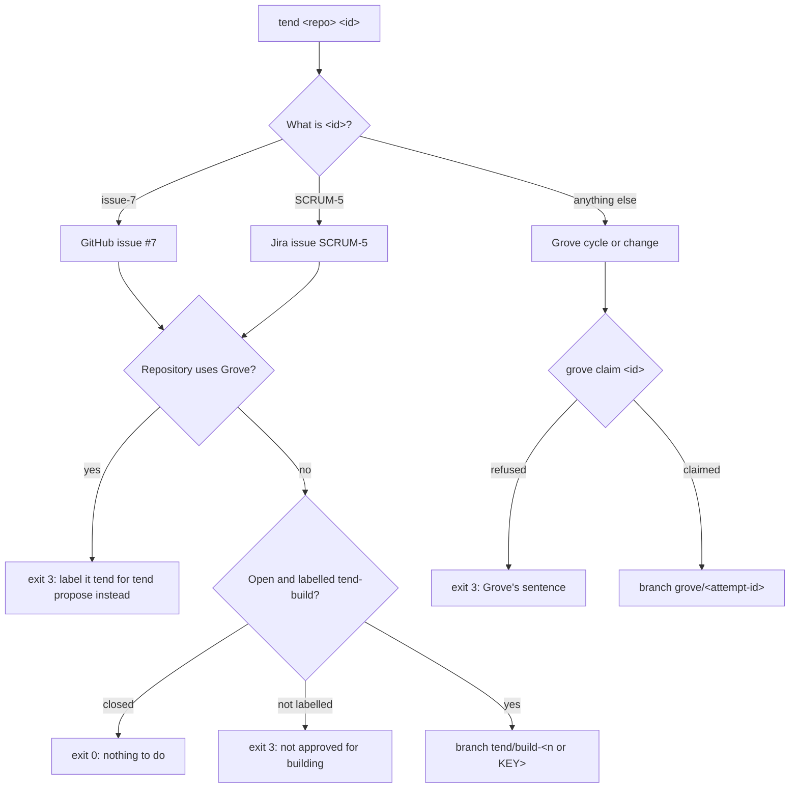

# Work items

A [work item](../glossary.md#work-item) is the one thing a tend builds. tend
tells the kinds apart by the ID's shape.

| ID | What it is | Where its scope comes from | Approved by | Branch |
| --- | --- | --- | --- | --- |
| `<change-id>` | An approved Grove change that no cycle lists, built as a cycle of that one change | The change's Grove documents | Merging its proposal | `grove/<attempt-id>` (Grove's claim makes it) |
| `<cycle-id>` | A Grove cycle: several changes built together | Its changes' Grove documents | Planning it | `grove/<attempt-id>` |
| `issue-<n>` | GitHub issue `#<n>`, in a repository **without** Grove | Its title and description | The `tend-build` label | `tend/build-<n>` |
| `<KEY>` (e.g. `SCRUM-5`) | A Jira issue of a mapped project, in a repository without Grove | Its summary and description | The `tend-build` label | `tend/build-<KEY>` |

- A **change a cycle lists** is built with its cycle. A change that waits on
  another is refused. Either way tend stops with Grove's sentence.
- A **Grove change or cycle** is done when every change is archived on the
  branch (`changes/archive/`) and the tree is clean.
- An **issue** is done when its branch has a commit and the implementer wrote
  notes for the reviewer in the run folder (`implemented`). A closed issue, or
  one whose pull request is merged, is "nothing to do" (exit 0).
- A Jira key looks like `^[A-Z][A-Z0-9_]*-[0-9]+$`. Its project must be mapped
  to this repository's origin in `TEND_STATE/jira`; see [Setup](../setup.md#jira).
- In a repository that uses Grove, `issue-<n>` and Jira keys are refused:
  requests go through a proposal first ([intake](intake.md)), so Grove's specs
  keep up with what is built.

The squash commit ends with a trailer that names the work item:
`Grove: <change-ids>`, `Closes #<n>` or `Refs <KEY>`.
