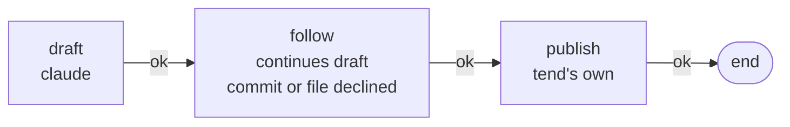

# Flows reference



*The built-in `propose` flow. The `build` flow is drawn on [Flows and steps](concepts/flows.md).*

Everything a flow file can say, and what tend does with it. The concepts are
on [Flows and steps](concepts/flows.md).

## The flow file

`tend/flow.yaml` on the target branch, read from `origin/<target>` (or the
local target without origin). Its top-level keys are:

| Key | What it is |
| --- | --- |
| `build` | Replaces the built-in `build` flow, which every attempt runs. |
| `propose` | Replaces the built-in `propose` flow, which [intake](concepts/intake.md) runs. |
| `watch` | `at_once: <N>`: [watch's count](concepts/watch.md). |
| `protect` | The [protected paths](#protected-paths), in place of tend's own list. |

A flow it does not name stays built in. Any other key is refused.

## The built-in flows

These are tend's own `flows/build.yaml` and `flows/propose.yaml`, as
`tend flow` prints them:

```yaml
# build: a Grove cycle or a work item, from its worktree to a reviewed head.
# The implementer builds it, a fresh reviewer judges each head, one repair
# follows a failure the reviewer calls actionable, tend publishes the head,
# and changes a person requests on the pull request go back to the
# implementer.
build:
  start: implement
  steps:
    implement:
      agent: claude
      prompt: prompts/implement-{kind}.md
      result: commit
      next:
        ok: review
    review:
      agent: codex
      prompt: prompts/review.md
      result: verdict verdict-{head}.json
      next:
        success: publish
        failure: publish
        actionable: repair
    repair:
      continue: implement
      prompt: prompts/repair.md
      result: commit
      limit: 1
      next:
        ok: review
        spent: publish
    publish:
      next:
        ok: end
        requested: request
    request:
      continue: implement
      prompt: prompts/request.md
      result: commit or file reply-{review_id}
      next:
        ok: review
```

```yaml
# propose: a request labelled tend, drafted as a Grove proposal. The drafter
# writes it, then commits it or says why there is none, and tend opens the
# pull request or answers the request.
propose:
  start: draft
  steps:
    draft:
      agent: claude
      prompt: prompts/draft.md
      next:
        ok: follow
    follow:
      continue: draft
      prompt: prompts/follow.md
      result: commit or file declined
      next:
        ok: publish
    publish:
      next:
        ok: end
```

## Step names

| Step | Flow | What it is |
| --- | --- | --- |
| `implement` | build | Claude builds the work item: `/grove-implement --runner <id>`, or `implement-issue.md` for an issue. It is the start, so its agent, `impl-<attempt-id>`, lasts the whole attempt. Asked whenever Git shows the branch unfinished, never when it is finished. A commit alone is not enough: before the flow goes past it, the work item must be built (a Grove change archived on the branch and a clean tree, or an issue's commit and notes; see [work items](concepts/work-items.md)). |
| `review` | build | A fresh Codex, `rev-<short head>`, judges each head and writes `verdict-<head>.json`. |
| `repair` | build | The implementer, given the findings, once (`limit: 1`). |
| `publish` | build, propose | tend's own. In build: push, pull request, reviews, status ([publication](concepts/publication.md)). In propose: the proposal pull request, or the decline comment. |
| `request` | build | The implementer makes the changes a person requested on the pull request. Each change request is asked once. |
| `land` | build only | tend's own, in no built-in flow: CI, then squash-merge ([landing](concepts/landing.md)). Needs `publish` in the flow. |
| `draft` | propose | Claude, `prop-<n>-<cksum>`, drafts a Grove change: `/grove-propose --unattended <request>`. |
| `follow` | propose | The drafter commits the change and writes `summary`, or writes `declined`. |

`end` and `person` are reserved: they are what follows a step, never step
names. A project may add its own steps with any other name, such as `resolve` and
`fix` after `land` ([Setup](setup.md#5-a-flow-that-lands)), or a second
reviewer:

```yaml
    review:
      agent: codex
      prompt: prompts/review.md
      result: verdict verdict-{head}.json
      next: {success: check, failure: publish, actionable: repair}
    check:                      # its prompt in tend/prompts/check.md
      agent: codex
      prompt: prompts/check.md
      result: verdict check-{head}.json
      next: {success: publish}
```

## Step fields

| Field | Value | Meaning |
| --- | --- | --- |
| `agent` | `claude` or `codex` | A fresh agent of that harness, started with tend's own flags. |
| `continue` | a step name | Prompt that step's agent again, in its conversation. A step has `agent` or `continue`, not both. |
| `prompt` | a path, e.g. `prompts/review.md` | Looked up as `tend/<path>` on the target for a project's flow, else in tend's own `flows/`. `{kind}` in the path becomes `grove` or `issue`. |
| `result` | see below | What tend checks when the turn ends. |
| `limit` | a whole number | How often the step may be asked in an attempt. Once used: `spent`. |
| `next` | outcome: step, `end` or `person` | Where each outcome goes. An outcome not listed stops for a person. |

`publish` and `land` take only `next`.

## Results

| Result | Done when |
| --- | --- |
| `commit` | The branch has a new commit since the ask. |
| `file <name>` | `<name>` in the run folder exists and is not empty. |
| `verdict <name>` | `<name>` in the run folder is a valid verdict for this head: `head` (this head), `conclusion` (`success` or `failure`), `actionable` (true or false) and `summary` (text). |
| `commit or file <name>` | Either of the two. |
| (none) | The agent's turn ends. |

A name may hold placeholders (`verdict-{head}.json`, `reply-{review_id}`) and
no `/`. Only verdicts named `verdict-…` are posted as reviews on the pull
request.

## Outcomes

| Step | Outcomes |
| --- | --- |
| `publish` in build | `ok`, `requested` (a person with write access requested changes on the head), `approved` (the newest such review on the head approves; only if the flow names it) |
| `publish` in propose | `ok` |
| `land` | `ok` (merged), `conflict` (the target does not merge in cleanly), `failed` (a check failed) |
| a step with a `verdict` result | `success`, `actionable` (failure the reviewer calls an in-scope fix), `failure` |
| any other step | `ok` |
| any step with a `limit` | also `spent` |

## Placeholders

Filled into prompts. `{head}`, `{findings}` and `{result}` are set for every
step.

| Placeholder | Value |
| --- | --- |
| `{branch}` | The attempt's branch. |
| `{base}` | `origin/<target>`, or the target without origin. |
| `{target}` | The target branch. |
| `{run}` | The run folder (an intake folder in propose). |
| `{item}` | The work item ID; in propose, `issue #<n>` or `issue <KEY>`. |
| `{head}` | The head the step is asked at. |
| `{result}` | The path of the step's result file. |
| `{findings}` | The last verdict's summary. |
| `{what}` | What the change must do: the Grove change folders the diff archives, or the quoted issue and the implementer's notes. |
| `{notes}` | Where the implementer's claims are: `implementation.md`, or `<run>/implemented` for an issue. |
| `{kind}` | `grove` or `issue`. |
| `{named}`, `{scope}` | An issue's name (`GitHub issue #7`) and its title, description and URL on one line. |
| `{who}`, `{review_id}`, `{review}`, `{comments}` | The person who requested changes, the review's ID, its body, and its line comments. |
| `{checks}` | After `failed` at `land`: the failed checks' names and links. |
| `{request}`, `{refs}`, `{ref}` | In propose: the request quoted with its link, the commit trailer (`Refs #7`), and `issue #7`. |

## Built-in prompts

`prompts/implement-grove.md`

```text
/grove-implement --runner {item}
```

`prompts/implement-issue.md`

```text
Implement {named} in this repository, asking no one. Its title and description are the agreed scope: {scope} Build what it asks and no more, with tests where the project has them, and commit on this branch. Then write to {run}/implemented, for an independent reviewer, what you built, what you ran to check it, and anything the issue asks that you did not do and why.
```

`prompts/review.md`

```text
You are the independent reviewer of branch {branch} at commit {head}. You did not write it and nobody can answer questions. The change is 'git diff {base}...HEAD'; what it must do is {what}. Check the code against those requirements and run the project's tests. Report only material findings: a defect, an unmet requirement, or a claim in {notes} the code does not support. Edit, stage and commit nothing. Your only output is the file {result}, exactly this JSON shape: {"head": "{head}", "conclusion": "success or failure", "actionable": true or false, "summary": "findings with file:line and what you ran"}. actionable is true only when every finding is an in-scope code fix that needs no decision from the owner.
```

`prompts/repair.md`

```text
An independent review of commit {head} found problems. Its findings: {findings} Fix each one that is in scope, run the tests, update {notes} where a claim changes, and commit. Ask no one.
```

`prompts/request.md`

```text
{who}, reviewing the pull request for {branch}, requested changes at commit {head}. Their review: {review}{comments} Make the changes they ask for that are within the agreed scope, run the tests, update {notes} where a claim changes, and commit. Then write to {run}/reply-{review_id}, for {who}, a few plain lines on what you changed and anything you did not and why; if you change nothing, commit nothing and still write it. Ask no one.
```

`prompts/draft.md`

```text
/grove-propose --unattended {request}
```

`prompts/follow.md`

```text
Without asking anyone: if you wrote a change, commit everything you wrote on this branch as one commit. Its subject proposes the change in this repository's commit style (see git log {target}); its body says what the proposal asks for and why, for someone reading the history later, and ends with the line '{refs}'. Then write to {run}/summary, for the person who will review it, the change's open questions, the consequential ones (behavior, scope, compatibility, data, costly interfaces) first and marked so, the routine ones after. If you wrote no document, commit nothing and write to {run}/declined, for the person who filed {ref}, a few plain lines on why no proposal could be drafted and what the request would need.
```

`prompts/conflict.md`

```text
tend could not land {branch} at {head}: {base} does not merge into it cleanly, so tend merged nothing and left the branch as it was. Merge {base} into the branch yourself, resolving each conflict so that both sides' intent holds, run the tests, update {notes} where a claim changes, and commit the merge. Ask no one.
```

`prompts/failed.md`

```text
tend could not land {branch} at {head}: checks GitHub ran on it failed. {checks} Find why each failed, fix what is in scope, run the tests, update {notes} where a claim changes, and commit. Ask no one.
```

## Validation

tend checks every flow it will run before any agent starts. A flow that
cannot run stops tend with exit 3, saying `tend/flow.yaml <why>`. It is
refused when the file:

- is empty, is not YAML, or holds a key tend does not know;
- gives a flow no steps, or starts it at a step it does not have;
- names a step `end` or `person`;
- gives `publish` or `land` anything but `next`, puts `land` outside `build`,
  or has `land` without `publish`;
- gives a step both or neither of `agent` and `continue`, an agent other than
  `claude` or `codex`, or a `continue` that leads to no step with an agent;
- gives a step no prompt, a prompt file that does not exist (for both kinds,
  where the path has `{kind}`), a result it cannot read, or a limit below 0;
- names an outcome a step cannot have, or a next step the flow does not have;
- loops through steps none of which has a limit. A loop through `publish`'s
  `requested` or `approved` is allowed: people bound it;
- gives `watch` an `at_once` that is not a whole number of at least 1;
- gives `protect` anything but a list of paths, or an empty entry.

While it runs, a step reached again at the same head with nothing asked since
stops for a person: the flow loops.

## Protected paths

At `land`, a head whose change against the target touches a protected path
lands only once a person with write access approves that head on GitHub (or
the head it is carried from by a clean merge of the target). Otherwise tend
merges nothing and stops (exit 3), naming the paths. The changed paths come
from Git, a renamed file counting under both names; no verdict or agent
waives the hold.

The protected paths are read from the target, never the candidate. With
`protect` in the flow file, they are its entries plus `tend/`, which stays
protected whatever the list says. Without it, tend's own list applies:

```yaml
protect: [tend/, .github/workflows/, CODEOWNERS, PRINCIPLES.md, grove.yaml,
  CLAUDE.md, AGENTS.md, .claude/, .agents/, .codex/,
  wrangler.*, fly.toml, vercel.json, netlify.toml, render.yaml, Procfile, Dockerfile,
  go.sum, package-lock.json, npm-shrinkwrap.json, yarn.lock, pnpm-lock.yaml,
  bun.lock, bun.lockb, Cargo.lock, Gemfile.lock, poetry.lock, uv.lock,
  Pipfile.lock, composer.lock]
```

An entry is a path from the repository's root. One ending in `/` covers that
folder, its own path (where a submodule may sit) and everything in it; one with no `/` matches a file of that name in
any folder (`CLAUDE.md` covers `web/CLAUDE.md`); `*` matches within one path
segment. `tend flow` prints the list in effect.

## Agents' flags

No flow sets flags; tend's are fixed per harness.

- **Claude**: `--permission-mode auto`, `--add-dir <run folder>`,
  `--disallowedTools "Bash(git push:*)" "Bash(gh pr:*)"`, and an appended
  system prompt: work on this branch in this worktree, push nothing, open or
  edit no pull request, create no branch or worktree; tend delivers.
- **Codex**: `-s workspace-write -c sandbox_workspace_write.network_access=true -a never --add-dir <run folder>`.

tend answers the folder-trust dialogs and Claude's `--add-dir` dialog itself,
skips a startup notice that offers `esc skip`, and never trusts Codex hooks:
that dialog stops for you.
