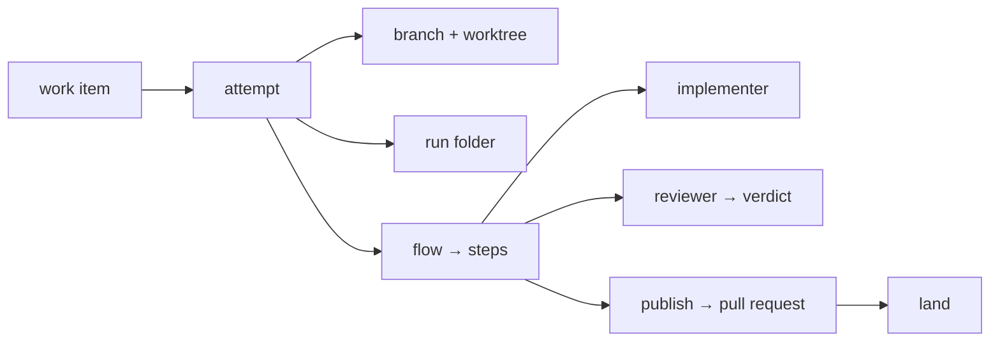

# Glossary

Each term once, with the name the code uses.

### Agent {#agent}
A Claude Code or Codex session tend starts in a terminal pane, found by its
name: `impl-<attempt-id>`, `rev-<short head>`, `prop-<n>-<cksum>`, or
`<step>-<short head>` for a project's own fresh step.

### Attempt {#attempt}
One try at a work item: a branch, a worktree and a run folder. For Grove work,
the record `grove claim` makes (ID like `261125-dwmge`). See [Attempts](concepts/attempts.md).

### Base {#base}
What new work starts from and is compared with: `origin/<target>`, fetched
first, or the local target without origin.

### Candidate {#candidate}
The attempt's branch at its head: what is reviewed, published and landed.

### Carried head {#carried-head}
A merge commit of the target into a reviewed head, with a tree exactly Git's
clean merge. It keeps the reviewed head's verdict, with no new review.

### Change {#change}
A Grove proposal for one piece of work. Approved by merging its proposal.
Built by `tend <repo> <change-id>` when no cycle lists it.

### Claim {#claim}
`grove claim <id>`: Grove records an attempt and makes its branch, or refuses
with a sentence saying why.

### Containment {#containment}
The check after each implementer turn that no worktree or branch with commits
appeared outside the attempt's branch.

### Count {#count}
`watch: {at_once: N}` in the flow file: how many attempts watch keeps going in
a repository on this runner. See [Watch](concepts/watch.md).

### Cycle {#cycle}
A Grove plan that builds several changes together into one candidate.

### Drafter {#drafter}
The Claude session intake starts to write a proposal from a request.

### Flow {#flow}
A named set of steps an attempt walks: `build` or `propose`, built in or from
`tend/flow.yaml`. See [Flows and steps](concepts/flows.md).

### Head {#head}
The newest commit of the attempt's branch.

### Implementer {#implementer}
The Claude session `impl-<attempt-id>` that builds the work item, repairs it
and makes requested changes. It lasts the whole attempt.

### Intake {#intake}
`tend propose`: requests labelled `tend` become Grove proposals. See [Intake](concepts/intake.md).

### Issue build {#issue-build}
A work item `issue-<n>` (or a Jira key) in a repository without Grove,
approved by the `tend-build` label, built on `tend/build-<n>`.

### Jira key {#jira-key}
A Jira issue ID such as `SCRUM-5`, from a project mapped in `TEND_STATE/jira`.

### Landing {#landing}
tend merging a reviewed pull request itself, at a `land` step. See [Landing](concepts/landing.md).

### Lock {#lock}
An `flock` that lets one tend at a time work on a work item (or set up, or
land). See [Locks](concepts/locks.md).

### Needs-you {#needs-you}
The status kind tend writes when it stops for a person (exit 3).

### Outcome {#outcome}
What a step gave: `ok`, `success`, `failure`, `actionable`, `spent`,
`requested`, `approved`, `conflict` or `failed`. A flow's `next` maps each to
what follows.

### Proposal {#proposal}
A pull request holding a drafted Grove change. Merging it approves the change.

### Publication {#publication}
The `publish` step: the branch, pull request, reviews and `tend/review`
status, as the bot account. See [Publication](concepts/publication.md).

### Publish file {#publish-file}
`TEND_STATE/publish`: `<origin-url> <account>` a line. See [The publish file](concepts/publish-file.md).

### Publishing account {#publishing-account}
The bot account named in the publish file. Every write tend makes on GitHub is
its.

### Record {#record}
A file in the run folder listing the heads a step was asked at, written just
before the prompt goes: `<step>-asked`, `request-<review id>`, `asked`,
`followed`.

### Recovery {#recovery}
How a rerun carries on from Git, the run folder and the terminal. See [Recovery](concepts/recovery.md).

### Repair {#repair}
The step where the implementer fixes an actionable failure. Once per attempt
in the built-in flow.

### Requested changes {#requested-changes}
GitHub's "Request changes" review on the pull request's head, by a person with
write access. The implementer makes them at the `request` step.

### Reviewer {#reviewer}
A fresh Codex session, `rev-<short head>`, that judges one head and writes its
verdict.

### Run folder {#run-folder}
`TEND_STATE/runs/<attempt-id>/`: an attempt's verdicts, records and status.

### Runner {#runner}
One machine's tends sharing a `TEND_STATE`: they share locks, run folders and
watch's count.

### Status {#status}
The run folder's `status` file: when, `working`, `needs-you` or `done`, what,
and the next action. `tend status` prints it.

### Step {#step}
One stage of a flow: an agent, a prompt, a result and where each outcome goes.

### Target {#target}
The branch work merges into: Grove's target, or the GitHub default branch.

### TEND_STATE {#tend_state}
The folder for tend's own files, default `~/.local/state/tend`. See [TEND_STATE](concepts/tend-state.md).

### Terminal {#terminal}
Where agents run, where you can watch and take over: Herdr (default) or rex.
Each worktree gets a place (a workspace or session); each agent a pane.

### `tend/review` {#tend-review}
The commit status tend sets on each reviewed commit: `success` or `failure`.

### Unattended {#unattended}
A mark on a Grove cycle's plan: approval for watch to start it with no one
there, when the flow file sets no count.

### Verdict {#verdict}
The reviewer's JSON for one head, `verdict-<head>.json`: `head`,
`conclusion`, `actionable` and `summary`.

### Watch {#watch}
`tend watch`: the loop that starts, reruns and runs intake with no one there.

### Work item {#work-item}
What one tend builds: a Grove change or cycle, `issue-<n>`, or a Jira key.
See [Work items](concepts/work-items.md).

### Worktree {#worktree}
The attempt's own Git checkout, on its branch, opened as a place in the
terminal.
