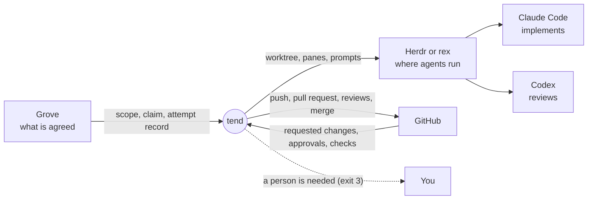

# tend

tend is a small Go program that takes one agreed [work item](glossary.md#work-item)
through coding agents and brings back a reviewed branch. [Grove](https://github.com/mascah/grove)
holds what is agreed. tend claims the work, has Claude Code implement it in a
[Herdr](glossary.md#terminal) (or rex) pane where you can watch, has Codex review
the head in a separate session, repairs once if the review asks, and, when the
repository is listed in the [publish file](concepts/publish-file.md), pushes the
branch and opens a pull request as a bot account. It merges only if the
project's [flow](concepts/flows.md) has a `land` step. It stores no progress of
its own that it trusts: every run reads again from Git, Grove, GitHub, the
terminal and its [run folders](glossary.md#run-folder), so a run that stops or
is killed carries on where it was. Start with [How a run goes](run.md).
