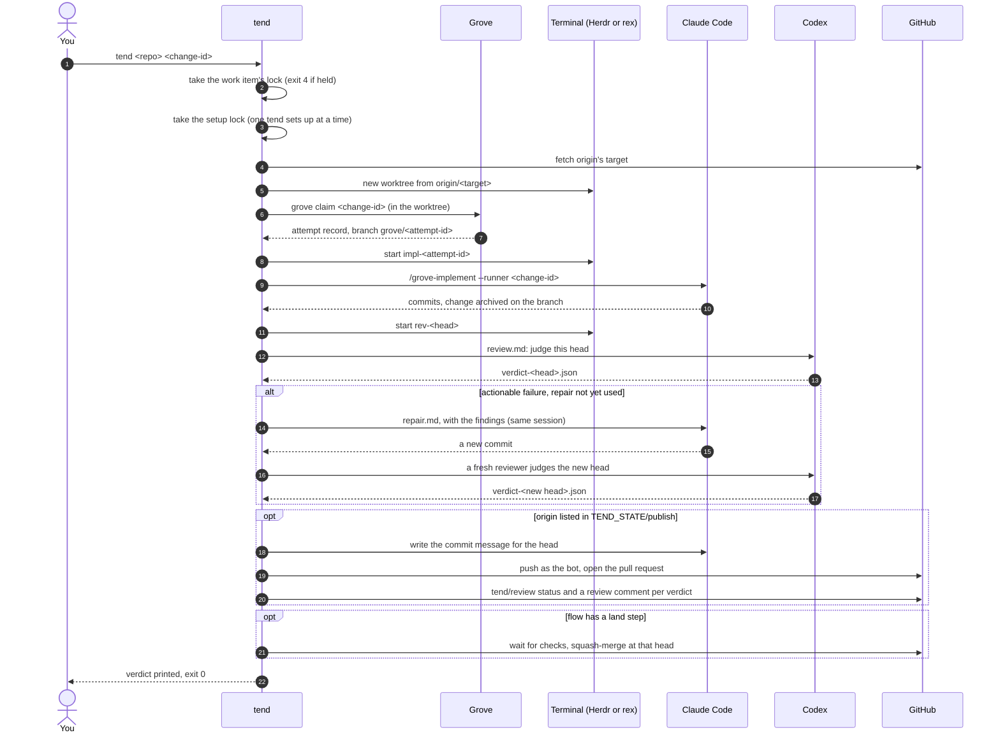

# How a run goes



This is one run of the built-in `build` [flow](concepts/flows.md), for an
approved Grove change. A cycle, an `issue-<n>` or a Jira key goes the same
way; only the claim and the scope differ (see [work items](concepts/work-items.md)).

## Step by step

1. **Lock.** tend takes the [lock](concepts/locks.md) for this work item in
   this repository. If another tend holds it, tend exits 4 and does nothing.
2. **Set up.** One tend at a time on this [TEND_STATE](concepts/tend-state.md)
   fetches origin's target, fast-forwards the local one, and tidies finished
   worktrees. It holds the setup lock until it has claimed.
3. **Claim.** If Grove already has an attempt at this work item whose checkout
   still holds its branch, tend carries on that
   [attempt](concepts/attempts.md). Otherwise it makes a worktree from
   `origin/<target>` and runs `grove claim <id>` inside it. Grove may refuse,
   for example when the change waits on another or shares a planned file with
   work in flight; tend then stops with Grove's sentence and leaves no worktree.
4. **Implement.** tend starts Claude Code as `impl-<attempt-id>` and sends it
   `/grove-implement --runner <id>`. The step is done when Git says so: the
   tree is clean and every change of the attempt is under `changes/archive/`
   on the branch.
5. **Review.** A fresh Codex session, `rev-<short head>`, judges the head and
   writes `verdict-<head>.json` in the run folder: `conclusion` (`success` or
   `failure`), `actionable` and a `summary`. It must not change the checkout.
6. **Repair.** If the verdict is a failure the reviewer calls actionable,
   the implementer's own session is given the findings once. Its new commit
   goes back to step 5 with a fresh reviewer. A second actionable failure
   finds the repair spent and goes on to publish.
7. **Publish.** If origin is listed in the [publish file](concepts/publish-file.md),
   tend [publishes](concepts/publication.md): it pushes the branch as the bot
   account, opens one pull request (draft if the head failed review), sets the
   `tend/review` status and posts each verdict as a review comment. If not, it
   says `not publishing` and keeps the verdict local.
8. **Requested changes (a later run).** tend does not wait for people. If a
   person with write access later uses GitHub's "Request changes" on the
   head, the next run (yours, or [watch](concepts/watch.md)'s) has the
   implementer make the changes, and the new head is reviewed and published
   again.
9. **Land.** Only if the project's flow has a `land` step:
   [landing](concepts/landing.md) merges the target in if it moved (a clean
   merge keeps the verdict), waits for CI, and squash-merges the pull request
   at exactly the head whose checks passed.
10. **Done.** tend prints the verdict JSON and exits 0. A Herdr notification
    says the pull request (or the branch, when nothing was published) is ready
    for you, or that it landed.

Without a `land` step, the built-in flow ends at publish: **merging is yours.**

## What it looks like

A run whose first review failed as actionable, was repaired, passed, and was
published (from tend's acceptance tests, whose agents are stand-ins; paths
shortened):

```text
$ tend ~/src/repo 261114-k0000
tend: claimed 261114-k0000 as attempt 261125-dwmge in <worktree>
tend: published https://example.test/pr/grove_261125-dwmge
tend: done: grove/261125-dwmge, verdict ~/.local/state/tend/runs/261125-dwmge/verdict-45914b823a2c447289dd504808a728ac0b3f849f.json
{
  "head": "45914b823a2c447289dd504808a728ac0b3f849f",
  "conclusion": "success",
  "actionable": false,
  "summary": "ok"
}
```

The same, with a `land` step:

```text
tend: published https://example.test/pr/grove_261125-nvpr3
tend: landed https://example.test/pr/grove_261125-nvpr3 at f368f41
tend: done: landed https://example.test/pr/grove_261125-nvpr3, verdict ~/.local/state/tend/runs/261125-nvpr3/verdict-f368f41dc6692bbe8cfb98bf09614f0bbf1dbfbe.json
```

## When Codex fails the head twice

The first actionable failure is repaired. When the repaired head fails again,
the repair is spent (its `limit` is 1), and the built-in flow sends `spent` to
`publish`. tend publishes the failed head: the pull request is made a draft,
`tend/review` is `failure`, and the review comment says "tend repairs once,
then a person decides". tend still **exits 0** and prints the failed verdict:

```text
$ tend ~/src/repo 261114-k0000
tend: claimed 261114-k0000 as attempt 261125-18jsc in <worktree>
tend: published https://example.test/pr/grove_261125-18jsc
tend: done: grove/261125-18jsc, verdict ~/.local/state/tend/runs/261125-18jsc/verdict-45914b823a2c447289dd504808a728ac0b3f849f.json
{
  "head": "45914b823a2c447289dd504808a728ac0b3f849f",
  "conclusion": "failure",
  "actionable": true,
  "summary": "a.txt:1 lacks the fix."
}
```

A failure that is **not** actionable (a finding needs a decision from the
owner) skips the repair and goes straight to publish, with the same result.
Running tend again does not repair a second time. What happens next is
yours: change the branch yourself, use GitHub's "Request changes" on the pull
request (the next run gives your review to the implementer), or close it.

This is the built-in flow, which has no `land`. In a flow that lands every
head (`publish: ok → land`), the failed head reaches `land`, which refuses it:
tend stops for a person (exit 3) with "did not pass review, so tend lands
nothing".

Codex never uses GitHub's "Request changes": its verdicts are posted as
comment reviews. A **person's** "Request changes" is different: each such
review goes to the implementer once, at the `request` step. There is no cap
on how many reviews a person may send, since people bound that loop (see
[publication](concepts/publication.md)).

## Exit codes

| Exit | Meaning |
| --- | --- |
| 0 | The flow ended: the verdict is printed (it may be a failure). Also "nothing to do": the issue is closed or its pull request is merged. |
| 1 | A command tend relies on failed unexpectedly (`tend: <error>`). |
| 2 | No work item was given: `usage: tend <repo> <id>`. |
| 3 | **A person is needed.** tend says why, records `needs-you` in the attempt's status, and notifies. |
| 4 | Another tend holds this work item's [lock](concepts/locks.md) (or, for `tend propose`, another intake pass of the repository). Nothing was done. |

## "A person is needed" (exit 3)

tend stops rather than guess. It prints the reason, writes it to the
attempt's `status` as `needs-you` with the next action ("a person deals with
that, then runs tend again"), and shows a Herdr notification titled
`tend <id> needs you` (under rex, its own tab says so). Some examples:

- Grove refused the claim, with Grove's sentence.
- An agent is `blocked` or in an `unknown` state, or did not start.
- A step was asked and left nothing (no commit, no verdict) and its agent is
  still there. tend names the record to delete to have it asked again.
- The implementer left work outside its branch, or a reviewer changed the
  checkout.
- A step's outcome goes to `person`, or to nothing in the flow.
- The flow file is not valid (before any agent starts).
- Landing: no CI on the pull request, checks still unfinished after
  `TIMEOUT_MS`, or GitHub refused the merge.

Deal with it, then run the same command again. It carries on; see
[recovery](concepts/recovery.md).
