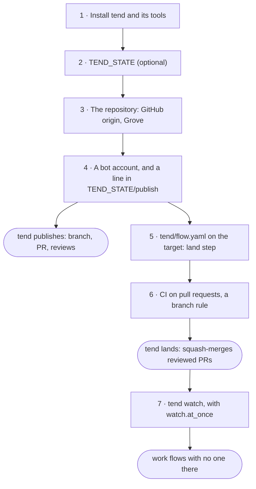

# Setup



Each step adds something: with 1 to 3, tend builds and reviews and keeps the
verdict local; with 4, it publishes; with 5 and 6, it lands; with 7, it runs
without you.

## 1. Install

```sh
curl -fsSL https://raw.githubusercontent.com/mascah/tend/main/install.sh | sh
curl -fsSL https://raw.githubusercontent.com/mascah/tend/main/install.sh | sh -s -- v0.1.0
```

This installs a release into `~/.local/bin` (`TEND_INSTALL_DIR` changes it).
Run it again to update. `tend version` says which you have. Or build it with
Go: `go build -o bin/tend .`

tend needs on `PATH`: `git`, `gh`, `grove` (0.14.0 or later), and Herdr or
rex. Claude Code and Codex must be installed and signed in. Run tend inside a
Herdr pane, or a rex terminal (`TEND_TERMINAL=herdr` or `rex` chooses).

## 2. TEND_STATE

Optional. tend keeps its files in `$TEND_STATE`, else `$XDG_STATE_HOME/tend`,
else `~/.local/state/tend` ([TEND_STATE](concepts/tend-state.md)). To skip
Claude's dialog for adding each run folder, trust that folder once: run
`claude` in it and choose "Yes, I trust this folder".

## 3. The repository

- An `origin` on GitHub that `gh` can see. Without origin tend still builds
  and reviews, and publishes nothing.
- **Grove** (`grove init`) to build changes and cycles, and to use
  [intake](concepts/intake.md). A repository **without** Grove can build
  GitHub issues labelled `tend-build` (`tend <repo> issue-<n>`) instead.

## 4. The bot account and the publish file

1. Make a separate GitHub account (a bot user) with write access to the
   repository, allowed to merge if tend will land.
2. Sign it in to `gh` beside yours: `gh auth login` as the bot, then
   `gh auth switch` back to yourself.
3. Add a line to `TEND_STATE/publish` with the exact origin URL and the bot:

    ```sh
    echo "$(git -C <repo> remote get-url origin) your-bot" >> ~/.local/state/tend/publish
    ```

Now `tend <repo> <id>` pushes the branch and opens the pull request as the bot
([publication](concepts/publication.md)). Merging is still yours.

## 5. A flow that lands

To have tend merge, commit `tend/flow.yaml` to the target branch and push it
(tend reads `origin/<target>`). Start from `tend flow <repo>`, saved as that
file, and add a `land` step with `resolve` and `fix` after it. You choose one of
two shapes.

### Supervised or autonomous

**Supervised:** a person with write access approves each head on GitHub before
it lands. `tend watch` sees the approval and runs the attempt again.

```yaml
    publish:
      next: {ok: end, approved: land, requested: request}
```

**Autonomous:** every head that passed review lands.

```yaml
    publish:
      next: {ok: land, requested: request}
```

Both then need:

```yaml
    land:
      next: {ok: end, conflict: resolve, failed: fix}
    resolve:
      continue: implement
      prompt: prompts/conflict.md
      result: commit
      limit: 1
      next: {ok: review}
    fix:
      continue: implement
      prompt: prompts/failed.md
      result: commit
      limit: 1
      next: {ok: review}
```

`prompts/conflict.md` and `prompts/failed.md` are tend's own; put files of
those names under `tend/prompts/` on the target to use yours instead.

## 6. CI and a branch rule

- **CI on pull requests is required.** A head with no check but `tend/review`
  stops for a person: tend lands nothing without CI.
- Set a branch rule on the target that requires the project's CI and
  `tend/review`, and requires branches to be up to date. tend checks the head
  itself; the rule closes the moment between its check and GitHub's merge.
- The bot must be allowed to merge and must not be able to bypass the rule.
- A rule that dismisses approvals on new commits undoes an approval whenever
  tend merges the target in.
- tend reads an approval once, at `publish`. A supervised project that wants a
  later withdrawal to hold the merge should require an approving review in
  the rule, so GitHub refuses and tend stops with its reason.

## 7. Run it without you

Add a count to the flow file and run watch in a pane of its own:

```yaml
watch:
  at_once: 2
```

```sh
tend watch <repo>
```

Without `at_once`, watch only starts cycles you plan and mark `unattended`.
See [watch](concepts/watch.md).

## Jira

Optional: a second source of requests and work items; code and pull requests
stay on GitHub.

- Add a line to `TEND_STATE/jira`: `<site> <project-key> <origin-url>`. One
  project maps to one repository, whose origin must also be in `publish`.
- Set `JIRA_EMAIL` and `JIRA_API_TOKEN` in tend's environment.
- `tend propose` then drafts the project's issues labelled `tend` and not
  done, on `tend/jira-<KEY>`. In a repository without Grove,
  `tend <repo> <KEY>` builds one labelled `tend-build`.
- Anyone who can edit issues in a mapped project can start an agent, so map
  only projects whose members you trust with that. tend never moves Jira
  issues through their workflow.

## Checklist: tend lands pull requests in a new repository

- [ ] tend, `git`, `gh`, `grove` ≥ 0.14.0, Herdr or rex installed; Claude Code and Codex signed in
- [ ] the repository has a GitHub `origin` and uses Grove (or builds `issue-<n>` without it)
- [ ] a bot account with write access and permission to merge, signed in to `gh`
- [ ] `<origin-url> <bot>` in `TEND_STATE/publish`
- [ ] `tend/flow.yaml` on origin's target with `land` (supervised or autonomous) and `resolve`/`fix`
- [ ] CI that runs on pull requests, and a branch rule requiring it and `tend/review`
- [ ] `tend <repo> <id>` run in a Herdr pane or rex terminal, or `tend watch <repo>`
